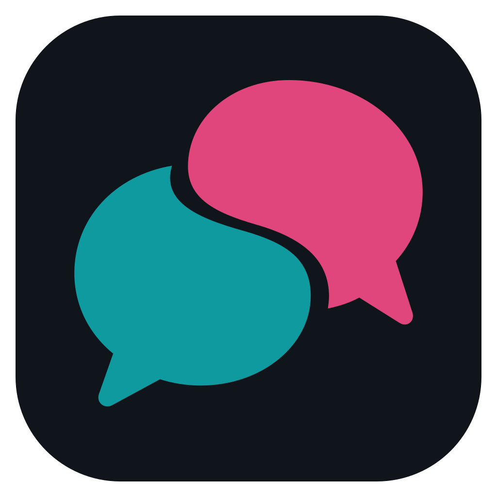
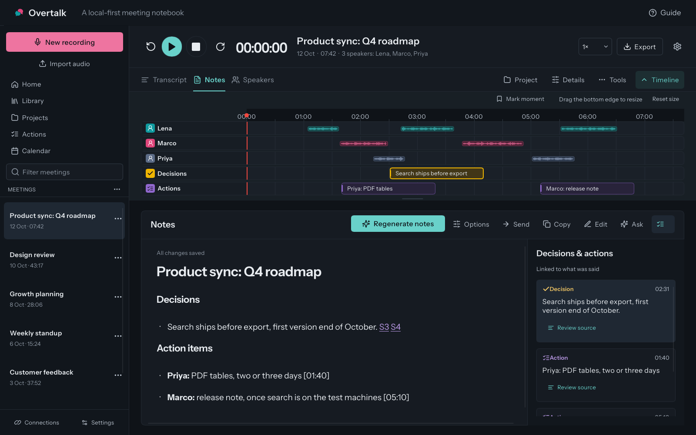
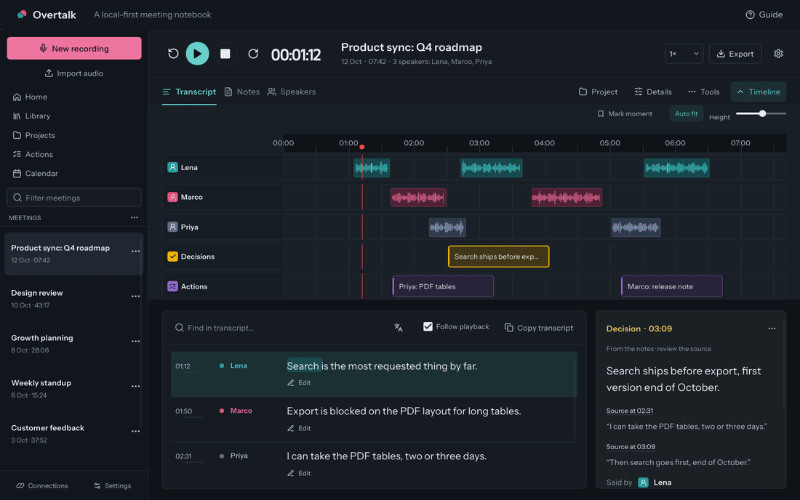
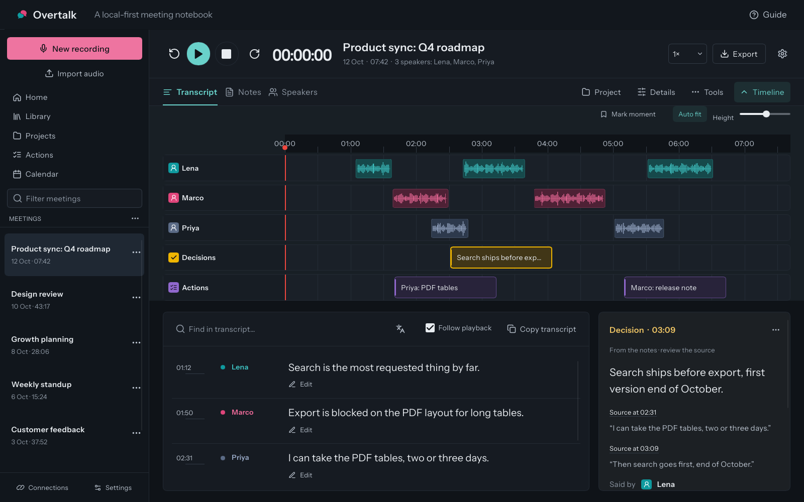
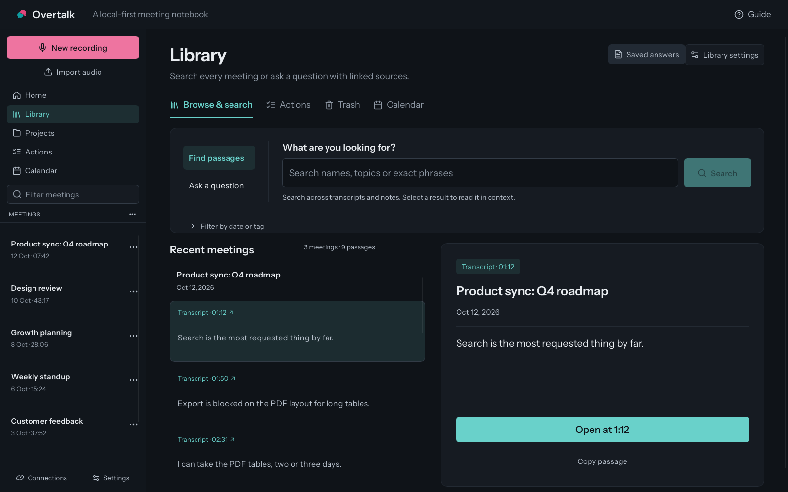

<p align="center">
  
</p>
<h1 align="center">Overtalk</h1>
<p align="center"><strong>Your meetings. Your context. On your machine.</strong></p>
<p align="center">A native meeting notebook for recording conversations, finding what was said,<br>and turning it into notes you can trace back to the source.</p>
<p align="center">
  <a href="#get-started">Get started</a> ·
  <a href="#see-the-workflow">Demo</a> ·
  <a href="#documentation">Documentation</a> ·
  <a href="#contribute">Contribute</a>
</p>
<p align="center"><sub>Developer preview 0.1.0 · No binary release yet: build from source · Tested on Linux; Windows and macOS unverified</sub></p>



<p align="center"><sub>Native Slint interface · Rust engine · Local storage · Optional cloud providers</sub></p>

## A conversation you can come back to

1. **Record or import.** Capture your microphone and call audio, or open an existing recording. No assistant needs to join the call.
2. **Review what happened.** Follow speaker lanes, search the transcript and play the passage behind a decision.
3. **Keep the useful context.** Edit your notes, collect actions, and organize meetings and people by project.

## See the workflow



**Play → follow the transcript → open Notes.** This 4.8-second animation plays once. [Open it again](docs/media/workflow.gif), or [view the transcript screenshot](docs/media/transcript.png).

All images use synthetic meetings in an isolated demo profile. The demo shows the real native interface and controller with a fixture service; it is not an accuracy benchmark. [Capture details](docs/media/README.md).

## Built around the meeting

| | What you can do |
| --- | --- |
| **🎙 Record & recover** | Capture microphone/system audio, pause and resume, import recordings, and recover interrupted work. |
| **💬 Read & listen** | Search timestamped transcripts, follow playback, inspect speaker lanes, and name or merge speakers. |
| **📝 Write with sources** | Generate and edit notes, choose a template, review the cited passage, and export PDF, DOCX, Markdown, TXT or JSON. |
| **🗂 Keep project context** | Group meetings, maintain people and vocabulary, and review proposed context learned from earlier conversations. Optional voice memory recognizes enrolled speakers. |
| **🔎 Find the answer** | Search across your library and ask questions with source passages you can open and check. |
| **🔗 Follow through** | Track actions, see upcoming meetings, and connect supported tools to prepare changes for review before publishing. |
| **📋 Prepare for the next one** | Meetings are filed into their project before and after the call, each choice with its reason, and a brief arrives before each meeting with every line linked to its source. |
| **📤 Pass it on** | Share one meeting as a self-contained web page or an `.overtalk` file, or let an AI assistant read your library through `overtalk-cli` and its MCP server. CLI and MCP access are off until you turn them on. |

<details>
<summary><strong>Explore the transcript and library</strong></summary>

### Every voice has a place



### Find the passage, keep its context



</details>

## Get started

Overtalk is an early developer preview (0.1.0) under active development. **No release has been published yet: build it from source.** **Linux is the tested desktop path**, and its packaging scripts produce a `.deb` and an AppImage. Windows (NSIS installer and portable zip) and macOS 14.2+ (`.app` in a `.dmg`) build, package and smoke-test in CI, but those jobs have not run yet and recording has not been verified on real Windows or Mac hardware; see [platform status](docs/PLATFORMS.md). Do not treat that as a ready-to-install release promise.

| You want to… | Start here |
| --- | --- |
| **Build the native desktop app** | [Platform prerequisites and sidecars](docs/BUILDING.md), then [Slint build, run and Linux installation](docs/NATIVE-UI.md#development). |
| **Use local speech models** | [Speech worker setup](speech-worker/README.md). Advanced speech uses a separate Python environment and local model files. |
| **Connect your tools** | [Account linking and provider setup](docs/CONNECTION-ACCOUNT-LINKING.md). Some providers require your own OAuth app registration. |
| **Work on the web interface** | [Web/Tauri development](docs/BUILDING.md#web-interface). Both interfaces share the Rust service. |

On Linux, after installing the [prerequisites](docs/BUILDING.md#prerequisites) (Rust, a C/C++ toolchain, the PipeWire, GTK and WebKit development packages, `bubblewrap` and `ffmpeg`):

```sh
git clone https://github.com/judeam/overtalk
cd overtalk
# The engine records which FFmpeg it was built against.
set -a; eval "$(python3 scripts/configure-ffmpeg-build.py)"; set +a
# Build the engine without the web interface's bundled sidecars.
export TAURI_CONFIG='{"build":{"frontendDist":"service-assets"},"bundle":{"externalBin":[],"resources":{}}}'
cargo build --release --locked \
  -p overtalk-native -p sonefold -p overtalk-capture -p overtalk-browser-bridge -p overtalk-worker-sandbox \
  --bin overtalk --bin sonefold-service --bin overtalk-capture --bin overtalk-browser-bridge --bin overtalk-worker
cargo build --release --locked -p llama-helper
cargo run --release --locked -p overtalk-native
```

[Building](docs/BUILDING.md#build-and-run-from-source-linux) explains each step and the optional speech-worker resources.

The app starts with an empty library. Its setup checklist downloads a speech model and a notes model when you ask it to.

The current product is **Overtalk**. Some names keep the earlier `sonefold` for compatibility: the service crate and binary (`sonefold`, `sonefold-service`), the app identifier and data folder (`com.judeam.sonefold`) and `SONEFOLD_*` settings.

## Local first, with explicit choices

Meetings and settings are stored locally, in a plain SQLite library protected by your operating system's disk encryption, not by Overtalk. Local speech and summary models let you process recordings without a cloud account; models must be downloaded and configured first. Choose models that fit your hardware.

Cloud AI providers receive the content you send when you select them. If you choose a cloud notes provider, Overtalk also uses it in the background to prepare briefs before calendar meetings (on by default for project meetings; Settings → Automation). Integrations are opt-in, and outgoing changes have a review step. There is no telemetry and no automatic updater. The [privacy policy](PRIVACY_POLICY.md#what-leaves-your-computer) lists every destination; see also [privacy controls](docs/PRIVACY-OPERATIONS.md), the [security policy](SECURITY.md) and the [security design](docs/SECURITY-ATTACK-SURFACE.md). Optional private AI summaries through an Overtalk subscription are planned and not on sale; their server is [`crates/cloud-gateway`](crates/cloud-gateway/README.md).

Tell people before you record them. In Germany, recording a non-public conversation without permission can be a criminal offence (§ 201 StGB), and other places have their own rules. Overtalk's recording notice step gives you a sentence to say or paste, and keeps it with the meeting.

Transcripts, speaker assignments and generated notes can be wrong. On real recorded meetings (the 16-meeting AMI test set), the built-in speech engine's word error rate is 34.8% on a close-talk headset mix and 38.3% on one table microphone, mostly words missed where people talk over each other; see [the AMI evaluation](evaluations/ami/README.md). Check important claims against the recording. Continuous live transcription is experimental; retain the audio when you need to reprocess it. Word highlighting is a reading aid, not a guarantee of word-level alignment.

## Documentation

| Using Overtalk | Building Overtalk |
| --- | --- |
| [Recording, notes and review](docs/ADVANCED_FEATURES.md) | [Codebase map and ownership](docs/CODEBASE-MAP.md) |
| [Library, search and backups](docs/LIBRARY.md) | [Native UI, LSP and verification](docs/NATIVE-UI.md) |
| [Connections](docs/CONNECTION-ACCOUNT-LINKING.md) · [CLI/MCP access](integrations/README.md) | [Contribution patterns](AGENTS.md) · [Quality checks](docs/QUALITY-TOOLS.md) |
| [Privacy and data operations](docs/PRIVACY-OPERATIONS.md) | [Platforms](docs/PLATFORMS.md) · [Release status](docs/RELEASE-STATUS.md) |
| [All documentation](docs/README.md) | [Security design](docs/SECURITY-ATTACK-SURFACE.md) · [Worker isolation](docs/WORKER-ISOLATION.md) |

## Contribute

Start with the [contributor guide](CONTRIBUTING.md) and [codebase map](docs/CODEBASE-MAP.md). Follow [AGENTS.md](AGENTS.md): find the existing owner, reuse behavior through real callers, and keep changes focused. YAGNI applies—unused frameworks and speculative extension points make this project harder to maintain.

```sh
# Rust, from the repository root, with the build environment from Get started.
cargo fmt --all -- --check
cargo clippy --release --workspace --all-targets -- -D warnings
cargo test -p sonefold --lib
cargo test -p overtalk-native

# Retained web interface; requires pnpm and Bun.
cd frontend
pnpm install --frozen-lockfile
pnpm typecheck
pnpm test
pnpm build
```

Never commit credentials, private meeting content, local model weights or generated build directories. Include relevant test results and screenshots with changes. CI is configured in `.github/workflows/` but has not run yet. Report security problems privately as described in [SECURITY.md](SECURITY.md).

## Where Overtalk comes from

Overtalk began on 30 September 2026 as a fork of the community edition of
[Meetily](https://github.com/Zackriya-Solutions/meetily) (v0.4.1, MIT,
© 2024 Zackriya Solutions). Its audio capture and parts of the Rust service still
come from there. Since the fork, Overtalk has:

- replaced the web-view interface with a native Slint desktop interface, now the default;
- run the optional speech worker and other inference workers in an OS-enforced sandbox with no credentials, app database or network (verified on Linux; Windows and macOS untested);
- made every note cite the passage it came from, and added projects, automatic filing and briefs before meetings;
- added voice memory that records the person's consent;
- added an evaluation harness for transcripts and notes ([meetingbench](evaluations/meetingbench/README.md));
- packaged it for Linux as a .deb and an AppImage.

On 20 October 2026, about 28% of non-blank source lines were still identical to a
line in the upstream file of the same name. Meetily's copyright and licence are
kept in [NOTICE.md](NOTICE.md).

## License

Overtalk is [MIT licensed](LICENSE.md), except voice memory (`crates/voice-memory/` and `frontend/src-tauri/src/extensions/voice_memory.rs`) and the vendored speech-worker code in `speech-worker/sonefold_speech/vendor/`, which are Apache-2.0. Code inherited from Meetily keeps its MIT notice in [NOTICE.md](NOTICE.md), with the other [third-party notices](NOTICE.md) and [brand assets](docs/brand/README.md). Downloaded model weights and bundled dependencies retain their own licenses.
